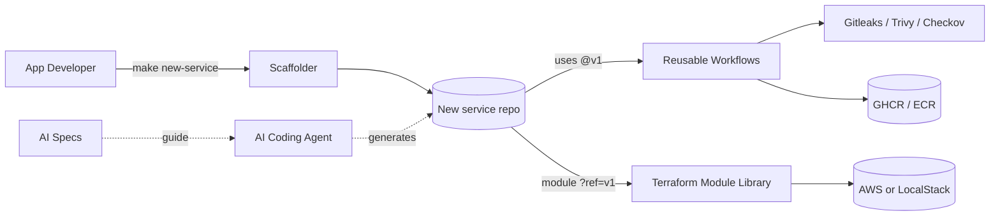
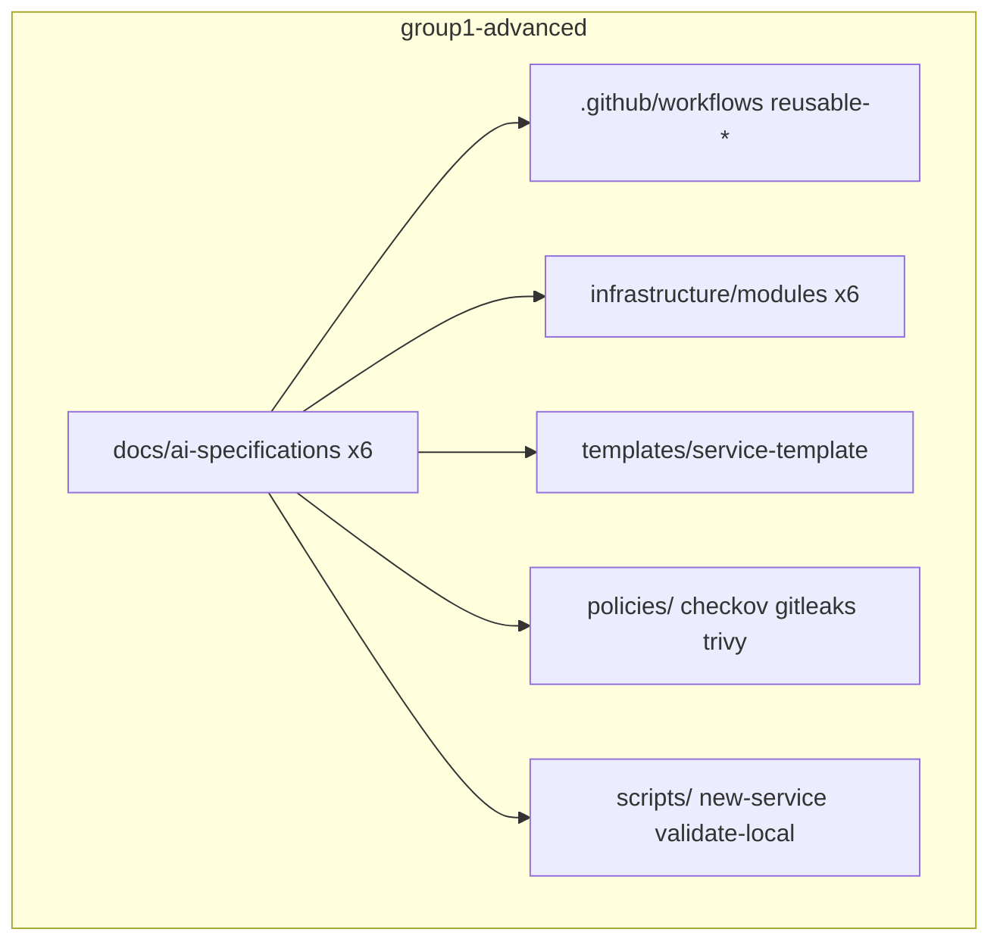
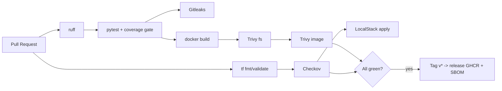
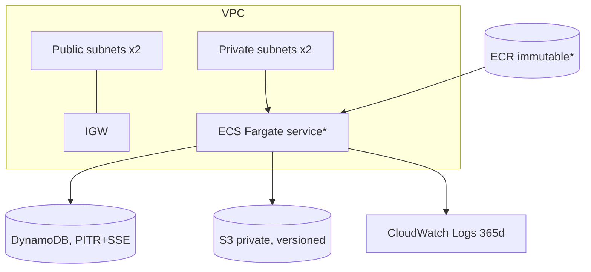
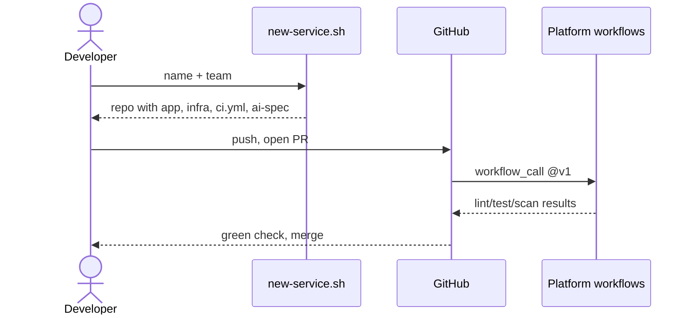

# Platform Architecture

## 1. Context

## 2. Platform repository components

## 3. CI/CD flow

## 4. Infrastructure (app-platform module)

\* created when `enable_compute = true`.

## 5. Onboarding sequence

## 6. Versioning & upgrade model
Platform releases `v1.x` (non-breaking) -> teams auto-benefit via `@v1`. Breaking -> `v2`, migration note + ADR; Dependabot proposes bumps.
